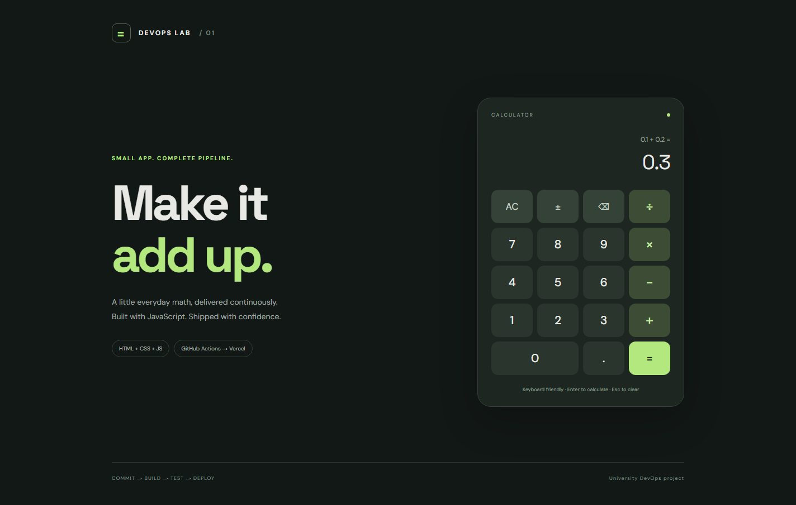

# DevOps Calculator

A responsive HTML/CSS/JavaScript calculator for a university DevOps assignment.
Supports addition, subtraction, multiplication, division, decimal numbers, negative
numbers, clearing, backspace, and keyboard input. Operations evaluate from left
to right; this is a basic calculator, not an expression parser.

## Verification status

- Public repository: https://github.com/tsurts/university-devops-calculator
- Production application: https://university-devops-calculator.vercel.app
- Local unit tests: 9 passed, 0 failed.
- Local build: successful.
- Local and production HTTP/content health checks: PASS.
- Live browser checks: 9 passed (buttons, decimals, error handling, sign, backspace, keyboard).
- GitHub Actions execution and pipeline screenshots: pending verification.

The first production deployment was made locally from the tested build artifact.
A successful local deployment is not evidence of a successful Actions pipeline.

## Run locally

Install Node.js 24 or newer and Git, then:

~~~sh
npm ci
npm test
npm run build
npm start
~~~

Open http://127.0.0.1:3000. No application dependencies or framework are needed.
The unit tests use Node's built-in test runner and cover all four operations,
decimal precision, negative results, invalid inputs, overflow, and division by zero.

Keyboard: digits and decimal point, + - * /, Enter or = to calculate,
Escape/Delete to clear, Backspace to remove the last digit.

## CI/CD

The workflow is in [.github/workflows/ci-cd.yml](.github/workflows/ci-cd.yml).
Pushes and pull requests targeting main or dev automatically run it.
Build and Test are separate jobs. Deploy waits for both to succeed.
Pull requests run Build and Test and skip deployment, so untrusted PRs cannot
access deployment credentials. Pushes to dev deploy a Vercel preview;
pushes to main deploy production. Manual workflow dispatch is also available.

Build copies the static source to dist/ and generates Vercel's Build Output API
artifact in .vercel/output/. The workflow uploads that artifact, and Deploy
downloads and deploys the same files using vercel deploy --prebuilt.

~~~mermaid
flowchart TD
    A[Push or pull request to main/dev] --> B[Build job: npm ci and npm run build]
    A --> C[Test job: npm ci and npm test]
    B --> D{Both successful and not a PR?}
    C --> D
    D -->|Yes| E[Deploy job: download artifact]
    E --> F{Branch}
    F -->|main| G[Vercel production]
    F -->|dev| H[Vercel preview]
    G --> I[HTTP and content health check]
    H --> I
    I --> J[Upload health-check.log]
    D -->|PR| K[Deployment skipped]
~~~

### Vercel configuration

Create a Vercel project for this static application. Add these repository Actions
secrets in GitHub Settings → Secrets and variables → Actions:

| Secret | Purpose |
| --- | --- |
| VERCEL_TOKEN | Vercel deployment token |
| VERCEL_ORG_ID | Account/team ID from linked project settings |
| VERCEL_PROJECT_ID | Vercel project ID |

Do not commit tokens or .vercel/project.json. Vercel CLI is pinned to the locally verified version 65.10.0. The workflow parses its JSON result and requires READY status. The CLI uses these secret values
to select the project. If Vercel deployment protection is enabled, configure
preview access for the health checker before requiring preview checks.
Disable Vercel's independent Git auto-deployments if connecting the same repository:
GitHub Actions should control deployment after tests.

## Health check

~~~sh
npm run health-check -- https://YOUR-DEPLOYMENT.vercel.app
~~~

Checks HTTP success and calculator HTML, retries up to five times, uses a
15-second timeout per request, and appends UTC timestamped PASS/FAIL records
to logs/health-check.log. Returns a nonzero exit code if unavailable.
The Deploy job runs it automatically and preserves the log as an Actions artifact.
This is a deployment check; continuous monitoring is not implemented.

## Branches and development

main is the production branch; dev is the integration branch.
Make meaningful commits on dev, open a pull request to main, inspect CI,
and merge to release. Secrets are only used by the Deploy job on push or manual runs.

## Screenshots and evidence

Production screenshot captured from https://university-devops-calculator.vercel.app
after exercising the actual calculator buttons:

[Local browser screenshot](docs/screenshots/calculator-local.png)

Pipeline and unit-test screenshots still need to be captured.
Required evidence to add before submission:

- Successful GitHub Actions run showing Build, Test, and Deploy.
- Expanded Test job showing passing unit tests.
- Running deployed calculator with its Vercel URL visible.

## Project layout

- src/: browser application and pure calculation module
- test/: unit tests
- scripts/build.mjs: static build and Vercel artifact
- scripts/serve.mjs: local preview server
- scripts/health-check.mjs: availability check and .log output
- .github/workflows/ci-cd.yml: three-job pipeline

## Reference documentation

- [Vercel CLI deployments](https://vercel.com/docs/cli/deploy)
- [Vercel Build Output API](https://vercel.com/docs/build-output-api)
- [Vercel with GitHub Actions](https://vercel.com/kb/guide/how-can-i-use-github-actions-with-vercel)

Optional monitoring dashboard and automatic rollback are not implemented.
