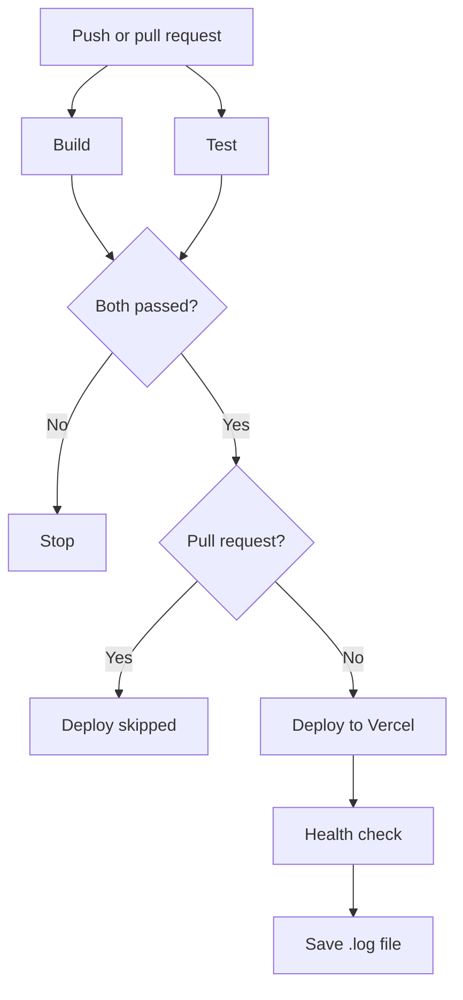
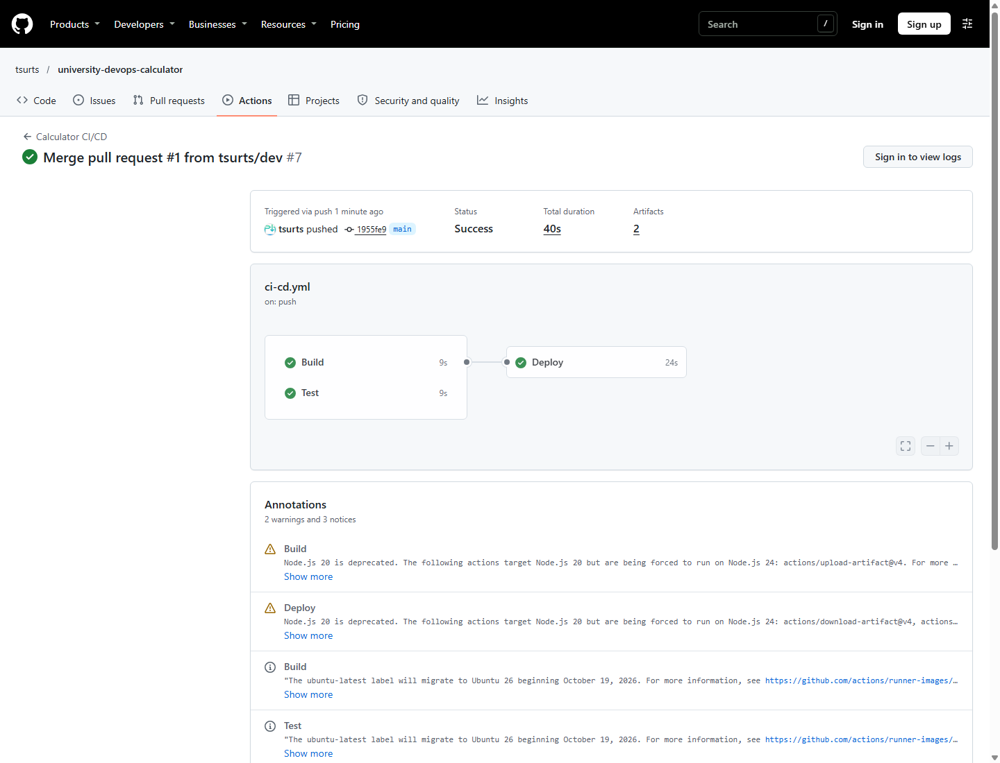
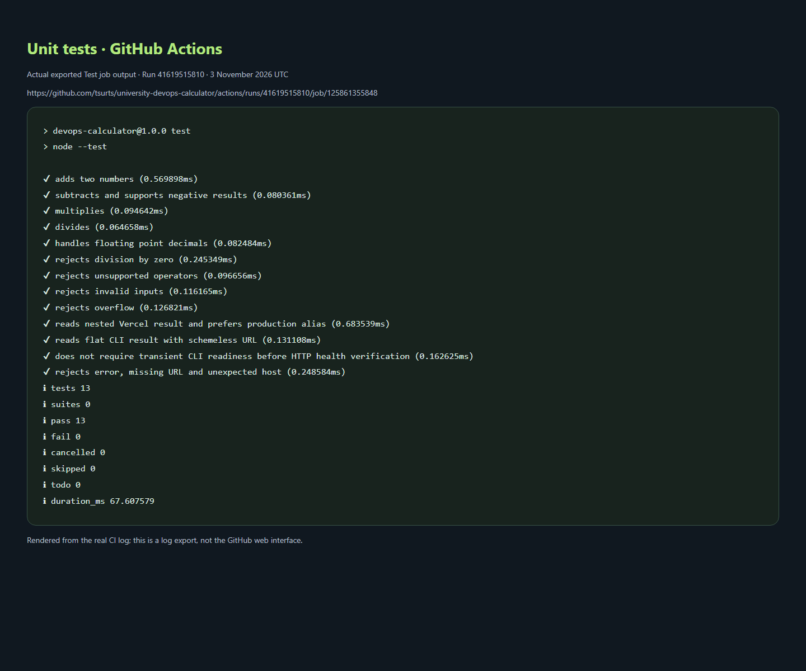
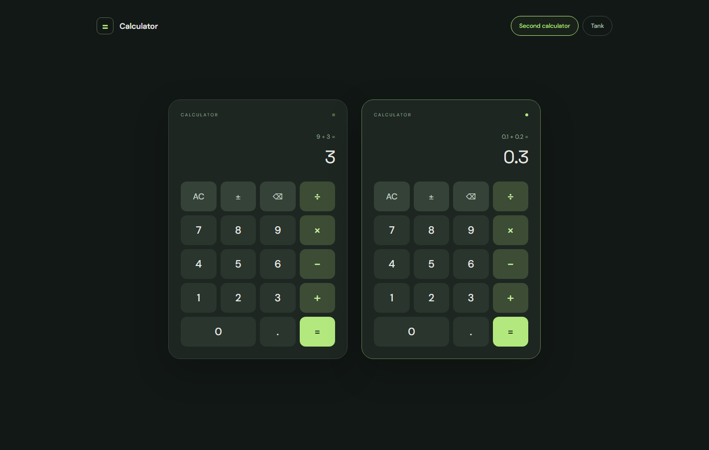

# DevOps Calculator

A calculator built with **HTML, CSS, and JavaScript** for a university DevOps assignment.
Supports basic arithmetic, decimals, keyboard input, a second calculator, and a decorative tank.

[Open the calculator](https://university-devops-calculator.vercel.app)

## CI/CD

The [GitHub Actions workflow](.github/workflows/ci-cd.yml) runs automatically on
pushes and pull requests to `main` and `dev`.

- **Build:** prepares Node.js and builds the static application.
- **Test:** runs 13 unit tests using Node.js's built-in test runner.
- **Deploy:** waits for Build and Test to pass, then deploys to Vercel.

`main` deploys production; `dev` deploys previews. Pull requests run Build and Test and skip Deploy.

## Workflow diagram

## Health check

The [health-check script](scripts/health-check.mjs) checks the deployed URL and calculator HTML,
then writes timestamped PASS/FAIL results to `logs/health-check.log`.
The pipeline preserves the log as an artifact. [Example log](docs/evidence/health-check.log).

## Screenshots

**Pipeline:** Build, Test, and Deploy completed successfully.
[View the run](https://github.com/tsurts/university-devops-calculator/actions/runs/41619924998).

**Unit tests:** 13 passed, 0 failed. Screenshot of the actual exported GitHub Actions test log.
[Source log](https://github.com/tsurts/university-devops-calculator/actions/runs/41619515810/job/125861355848).

**Application:** two independent calculators running on Vercel.

