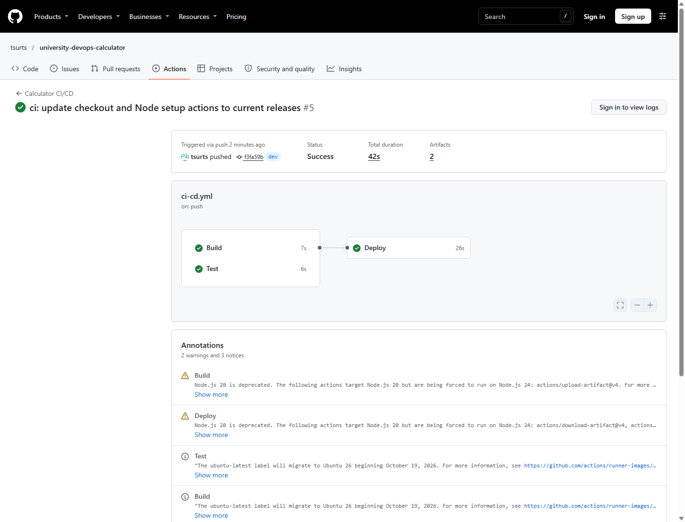

# DevOps Calculator

A responsive HTML/CSS/JavaScript calculator built for a university DevOps
assignment. Supports addition, subtraction, multiplication, division, decimals,
negative numbers, backspace, and keyboard input. Operations evaluate from left
to right, as on a basic calculator.

The **Second calculator** button reveals an independent calculator from behind
the first, sliding it to the left on desktop (stacking below on small screens).
Click or focus either calculator to direct keyboard input to it. **Tank** hides
the calculators and shows a decorative tank cutout. **Back to calculator**
restores the calculators and their values.

- **Live application:** https://university-devops-calculator.vercel.app
- **Public repository:** https://github.com/tsurts/university-devops-calculator
- **Workflow:** [.github/workflows/ci-cd.yml](.github/workflows/ci-cd.yml)
- **Merged development PR:** [dev into main, #1](https://github.com/tsurts/university-devops-calculator/pull/1)

## Verified results

Verified on 3 November 2026:

| Requirement | Evidence |
| --- | --- |
| Working application | Live Vercel application; 9 browser interaction checks passed |
| Unit tests | 13 passed, 0 failed locally and on GitHub |
| Public GitHub repository | Repository link above |
| main and dev branches | Both retained with meaningful application, test, CI, and documentation commits |
| Separate Build, Test, Deploy jobs | [Successful production run](https://github.com/tsurts/university-devops-calculator/actions/runs/41619924998) |
| Automatic push trigger | [Successful dev push run](https://github.com/tsurts/university-devops-calculator/actions/runs/41619705157) and production run |
| Automatic pull-request trigger | [Successful PR run](https://github.com/tsurts/university-devops-calculator/actions/runs/41619711377); Deploy intentionally skipped |
| Vercel deployment through CI | Production Deploy job passed and application health was verified |
| Health-check script and .log | [Script](scripts/health-check.mjs), [actual CI log](docs/evidence/health-check.log) |
| Documentation and screenshots | This README, workflow diagram, and screenshots below |

## Run locally

Install Node.js 24 or newer and Git. Clone the repository, then run:

~~~sh
git clone https://github.com/tsurts/university-devops-calculator.git
cd university-devops-calculator
npm ci
npm test
npm run build
npm start
~~~

Open http://127.0.0.1:3000.

There are no application dependencies. Unit tests use Node's built-in test
runner. Nine tests cover arithmetic, decimal precision, negative results,
invalid inputs, overflow, and division by zero. Four additional regression
tests cover deployment-response parsing.

Use buttons or a keyboard: digits, decimal point, + - * /, Enter or = to
calculate, Escape/Delete to clear, and Backspace to remove the last digit.

## CI/CD workflow

Pushes to main and dev, and pull requests targeting either branch, automatically
trigger the workflow. Manual workflow dispatch is also supported.

1. **Build:** checks out the commit, sets up Node.js 24, runs npm ci, and builds
   static files into dist/ and a Vercel Build Output API artifact into
   .vercel/output/. The artifact is uploaded for Deploy.
2. **Test:** independently checks out the same commit, sets up Node.js 24,
   runs npm ci, and runs all 13 unit tests.
3. **Deploy:** waits for both jobs to succeed, downloads the built artifact,
   and runs vercel deploy --prebuilt. Pushes to dev create preview deployments;
   pushes to main publish production. A health check then verifies the returned
   deployment URL. The deployment JSON and health-check log are uploaded as
   the health-check-log artifact, including on failure when files exist.

Pull requests run Build and Test and skip Deploy. They validate proposed changes
without receiving deployment credentials. A later merge to main triggers the
production deployment. A failed Build or Test prevents Deploy from running.
A failed health check fails the Deploy job; automatic rollback is not implemented.

~~~mermaid
flowchart TD
    A[Push or pull request to main/dev] --> B[Build job]
    A --> C[Test job]
    B --> B1[Build and upload static artifact]
    C --> C1[Run 13 unit tests]
    B1 --> D{Both passed?}
    C1 --> D
    D -->|No| X[Deployment blocked]
    D -->|Yes| E{Pull request?}
    E -->|Yes| F[Deploy skipped]
    E -->|No| G[Deploy job downloads artifact]
    G --> H{Branch}
    H -->|main| I[Vercel production]
    H -->|dev| J[Vercel preview]
    I --> K[HTTP and content health check]
    J --> K
    K --> L[Upload deployment JSON and health-check.log]
~~~

### Deployment configuration

The repository uses GitHub Actions to control delivery. Vercel CLI is pinned
to version 65.10.0. The deployment parser supports flat and nested CLI results;
the CLI exit code and HTTP/content health check determine deployment success.

Configure these repository Actions secrets when reproducing the project:

| Secret | Purpose |
| --- | --- |
| VERCEL_TOKEN | Vercel token scoped to the deployment account/team |
| VERCEL_ORG_ID | Vercel account/team ID |
| VERCEL_PROJECT_ID | Vercel project ID |

The Vercel project uses no framework, npm run build as its build command,
dist as its output directory, and Node.js 24. The CI pipeline deploys the
prebuilt artifact instead of rebuilding on Vercel. Preview protection is
disabled for this public demonstration so the HTTP checker can reach previews.
An independent Vercel Git integration is not required or connected.

Tokens, local environment files, .vercel/, dependencies, generated build
output, and runtime logs are ignored by Git. The documentation includes one
explicitly committed health-check log as assignment evidence.

## Health check

~~~sh
npm run health-check -- https://university-devops-calculator.vercel.app
~~~

The script checks HTTP success and verifies the calculator's title and display
element. It retries up to five times with a 15-second timeout per request.
Each attempt appends a UTC timestamp, PASS/FAIL, attempt number, URL, status,
content result, and duration to logs/health-check.log. Failure returns a nonzero
exit code. Set APP_URL instead of the argument, or HEALTH_LOG to change the log path.

[Production CI health log](docs/evidence/health-check.log):

~~~text
2026-11-03T10:31:46.201Z PASS attempt=1 url=https://university-devops-calculator.vercel.app/ status=200 content=valid duration_ms=276
~~~

Download fresh deployment evidence from the health-check-log artifact on any
completed push workflow run. This checks deployment availability; continuous
monitoring and a monitoring dashboard are not implemented.

## Screenshots

### Successful production pipeline

Actual GitHub Actions page showing Build, Test, and Deploy all successful:
[production run](https://github.com/tsurts/university-devops-calculator/actions/runs/41619924998).

### Successful development pipeline

[Preview run](https://github.com/tsurts/university-devops-calculator/actions/runs/41619705157).

### Passing unit tests

Screenshot of the actual exported GitHub Test job output, rendered for readability.
The public GitHub web interface requires sign-in to view job logs.
[Source job](https://github.com/tsurts/university-devops-calculator/actions/runs/41619515810/job/125861355848)
and [exported output](docs/evidence/unit-tests.txt).

### Running application

Captured from https://university-devops-calculator.vercel.app during the final
browser check. The calculators independently show 0.1 + 0.2 = 0.3 and 9 / 3 = 3.

## Branch workflow

main is the production branch; dev is the integration branch. Develop and commit
on dev, push to run preview CI, open a pull request into main, inspect the checks,
then merge to release. Both branches are retained. The commit history records
the application, tests and pipeline, deployment-parser fix, action updates,
and verified documentation as meaningful changes.

## Project layout

- src/: browser HTML, CSS, UI JavaScript, and pure calculation module
- test/: arithmetic and deployment-response regression tests
- scripts/build.mjs: static build and Vercel artifact
- scripts/deployment-url.mjs: deployment-response parser
- scripts/serve.mjs: local preview server
- scripts/health-check.mjs: availability check and .log output
- .github/workflows/ci-cd.yml: three-job pipeline
- docs/screenshots/: actual application, pipeline, and test-output captures
- docs/evidence/: exported test output and production health-check log

## Reference documentation

- [Vercel CLI deployments](https://vercel.com/docs/cli/deploy)
- [Vercel Build Output API](https://vercel.com/docs/build-output-api)
- [Vercel with GitHub Actions](https://vercel.com/kb/guide/how-can-i-use-github-actions-with-vercel)
- [GitHub workflow syntax](https://docs.github.com/en/actions/writing-workflows/workflow-syntax-for-github-actions)
